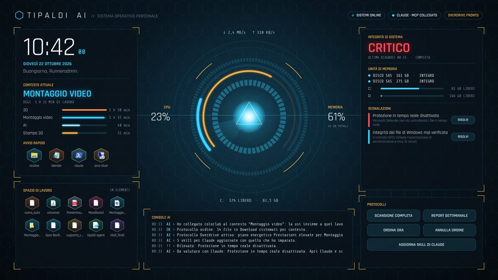
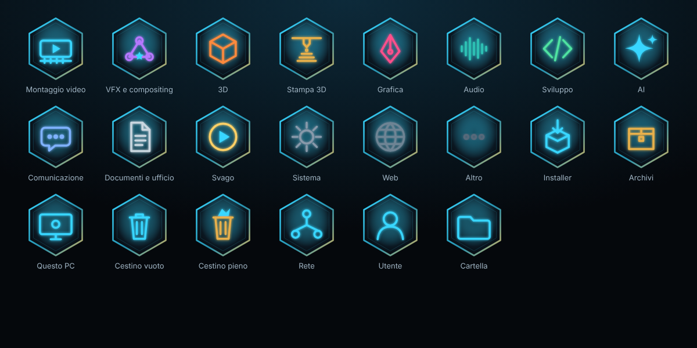

# Tipaldi AI — il tuo PC in stile Stark

Tipaldi AI trasforma Windows 10 in una postazione **HUD futuristica con intelligenza artificiale**:
- un desktop animato che mostra lo stato del PC e il tuo lavoro;
- la diagnosi continua di dischi e integrità, con riparazioni automatiche sicure;
- un sistema che impara come lavori e ordina file e app per contesto;
- un report settimanale;
- skill per Claude, collegato tramite **MCP**.

**Non tocca** file di sistema, servizi, driver o processi di sistema. Ogni modifica viene salvata e si annulla con un clic.



> Progetto personale non ufficiale, senza legami con Marvel o Disney. Grafica, icone, cursori e suoni sono originali e generati dagli script in `tools/`.

---

## Installazione (3 passi)

1. **Scarica** `TipaldiAI-Setup.exe` dalla cartella [`W`](../W) del repository: un solo file con dentro tutto.
2. **Doppio clic** sull'exe. Se Windows mostra "Windows ha protetto il PC", clicca **Ulteriori informazioni → Esegui comunque**: l'exe non ha una firma digitale, che è a pagamento.
3. Scegli cosa attivare e premi **INSTALLA**.

Non servono privilegi di amministratore. Riavvia Claude Desktop dopo l'installazione, per vedere gli strumenti di Tipaldi AI.

## Tornare a com'era prima

- Riapri l'exe e premi **Ripristina originale**.
- In alternativa usa `TipaldiAI-Setup.exe --ripristina`.

Il ripristino riporta indietro tema, colori, sfondo, icone, cursori, suoni, font e impostazioni, e toglie Tipaldi AI e il collegamento con Claude.
**I tuoi dati restano**: attività, report e skill sono in `%LOCALAPPDATA%\TipaldiAI` e `%USERPROFILE%\.claude\skills\tipaldi-*`. Se non ti servono, eliminali a mano.

---

## Tipaldi AI: cosa fa

| Funzione | Cosa fa | Quando |
|---|---|---|
| **Desktop futuristico** | Reattore animato con anelli CPU/RAM, rete e disco, contesto di lavoro attuale, avvio rapido delle app che usi di più, desktop ordinato per contesto, console AI | Sempre: è lo sfondo di Windows (livello sfondo di Esplora risorse, dietro alle icone). Non è una finestra: niente barra delle applicazioni né Alt+Tab, resta con Win+D, le icone e il menu del desktop restano quelli di Windows |
| **Diagnosi** | Salute dei dischi fisici (SSD/HDD/NVMe), previsione guasti S.M.A.R.T., settori danneggiati ed errori NTFS nel registro eventi, spazio libero, antivirus, riavvii in sospeso, memoria, app bloccate, integrità di Windows | Rapida ogni 10 minuti, completa ogni ora e a richiesta |
| **Riparazioni sicure** | Pulizia dei file temporanei, riavvio di Esplora risorse, cache di icone e anteprime, cache DNS | **In automatico** |
| **Riparazioni con conferma** | SFC, DISM, CHKDSK, ottimizzazione delle unità, chiusura di app bloccate, svuotamento del cestino | Solo dopo il tuo **sì** sul desktop, anche quando le chiede Claude |
| **Claude (MCP)** | Claude Desktop e Claude Code vedono stato del PC, attività, report e skill, e possono avviare riparazioni con le regole qui sopra. Se Claude Code è installato, i problemi senza riparazione sicura gli vengono passati da soli | Usa il tuo abbonamento Claude: nessuna chiave API, nessun costo a consumo |
| **Contesti di lavoro** | Riconosce cosa stai facendo dall'app e dal titolo della finestra: montaggio video, VFX, 3D, stampa 3D, grafica, audio, sviluppo, AI, comunicazione, documenti, svago. Le app nuove le collega da solo al contesto giusto | Ogni 5 secondi (le finestre private non vengono registrate) |
| **Protocollo Overdrive** | Piano energetico "Prestazioni elevate" mentre monti, componi o fai 3D; rimette il tuo piano dopo | In automatico |
| **Protocollo ordine** | Sistema Desktop e Download in cartelle per contesto (Montaggio video, Stampa 3D, Installer...) con icone dedicate. Si annulla con **ANNULLA ORDINE** | Una volta al giorno, quando sei via |
| **Report settimanale** | Ore per contesto, app e progetti più usati, mappa degli orari, cosa ha imparato l'AI, salute del PC, suggerimenti | Ogni lunedì (pulsante **REPORT SETTIMANALE**) |
| **Skill per Claude** | Trasforma quello che ha imparato in skill (`~/.claude/skills/tipaldi-*`) e in zip da caricare su claude.ai | Ogni settimana, oppure con **AGGIORNA SKILL DI CLAUDE** |
| **Icone** | Set esagonale luminoso per i contesti e per Questo PC, Cestino, Rete e cartella utente | All'installazione (si ripristinano) |



### Usarlo con Claude

Dopo l'installazione apri Claude Desktop e scrivi, per esempio:
- "Tipaldi, controlla il sistema e sistema quello che puoi."
- "Su cosa ho lavorato questa settimana?"
- "Aggiorna la skill del mio montaggio video con quello che hai visto."

Gli strumenti MCP sono 15. I principali: `system_status`, `run_health_check`, `apply_fix`, `activity_summary`, `activity_timeline`, `weekly_report`, `organize_apply`, `skill_write`.

### Impostazioni

Sono in `%LOCALAPPDATA%\TipaldiAI\settings.json`. Si possono spegnere una per una:
- registrazione dell'attività e dei titoli delle finestre;
- riparazioni automatiche e passaggio dei problemi a Claude;
- Overdrive;
- riordino di Desktop e Download;
- report e skill;
- desktop.

Il menu dell'icona vicino all'orologio permette di nascondere il desktop, avviare una scansione, aprire il report o uscire.

---

## Il tema (cosa cambia in Windows)

| Parte di Windows | Cosa diventa | Come |
|---|---|---|
| Colori e modalità | Scuro, accento ciano reattore, tavolozza con oro, trasparenze | Registro utente + API di sistema |
| Sfondo | "Arc Reactor" 4K (versione ultrawide inclusa) | Nativo |
| Schermata di blocco e accesso | Reattore centrato | API Windows (WinRT) |
| Puntatori | 17 cursori vettoriali multi-risoluzione, attesa animata | Schema cursori nativo |
| Suoni | Notifiche "vetro", errori morbidi, cestino "dissolvenza", power-up all'accesso | Schema suoni nativo |
| Font | Rajdhani + Share Tech Mono (licenza OFL) | Solo per il tuo utente |
| Ricerca | Barra stile Spotlight con `Alt+Spazio` | [Flow Launcher](https://github.com/Flow-Launcher/Flow.Launcher) |
| Barra delle applicazioni | Trasparente sul desktop, acrilico con finestre aperte | [TranslucentTB](https://github.com/TranslucentTB/TranslucentTB) |
| Opzionali | Icone centrate (TaskbarX), menu tasto destro (Nilesoft Shell), sfondo animato (Lively), widget classici (Rainmeter) | Spenti di default |

## Tre livelli di sicurezza

| Livello | Cosa include | Tocca processi di sistema? |
|---|---|---|
| **1 — Nativo** | Tipaldi AI, tema, colori, sfondo, icone, blocco schermo, cursori, suoni, font, ottimizzazioni | No. Solo impostazioni e cartelle dell'utente (HKCU, %LOCALAPPDATA%). SFC/DISM/CHKDSK solo con la tua conferma e l'UAC |
| **2 — Overlay** | Lively, Rainmeter, Flow Launcher, TranslucentTB, TaskbarX | No. App separate, open source, senza iniezioni |
| **3 — Avanzato** (spento di default) | Nilesoft Shell, Windhawk | Si agganciano a Esplora risorse (non a componenti critici). Facoltativo |

I progetti che si iniettano in `dwm.exe` (il compositore grafico di Windows) sono stati **esclusi di proposito**. Il perché è spiegato in [docs/RICERCA.md](docs/RICERCA.md).

## Ottimizzazioni incluse

Tutte riguardano solo il tuo utente, tutte sono reversibili. Le trovi nella scheda **Ottimizzazioni** e puoi attivarle una per una.

- **Fluidità:** menu più reattivi (400 → 120 ms), avvio del desktop senza ritardo artificiale, testo ClearType.
- **Prestazioni:** modalità gioco automatica, niente registrazione Game DVR in background, app dello Store in background (spenta di default), piano energetico "Prestazioni elevate" (spento di default; consuma batteria).
- **Pulizia:** niente pubblicità né app suggerite, schermata di blocco senza Spotlight, ricerca Start solo locale (niente Bing), pulizia dei file temporanei più vecchi di 3 giorni.
- **Interfaccia:** barra minimale, niente "Notizie e interessi", Esplora file apre "Questo PC". Opzionali: estensioni dei file visibili, desktop senza icone, barre del titolo color reattore.

L'interfaccia resta leggera:

- Gli anelli dello sfondo animato ruotano sulla GPU: costo CPU quasi zero.
- Le particelle sono limitate a 30 FPS e restano vicino al reattore.
- Lively mette in pausa lo sfondo con giochi e video a schermo intero.
- I widget Rainmeter si aggiornano una volta al secondo; il control center non si aggiorna mai.

**Cosa non fa, per scelta:** non disattiva Windows Defender, servizi o aggiornamenti; non rimuove app di sistema; non modifica `uxtheme.dll` o altri file di sistema.

---

## Requisiti

- Windows 10 a 64 bit, versione 1809 o successiva (consigliata 22H2). Su Windows 11 funziona in parte.
- Windows PowerShell 5.1, già presente in Windows 10.
- Per le app del Livello 2: **winget** ("Programma di installazione app" dal Microsoft Store). Senza winget si installa solo il Livello 1.

## Personalizzare

- **Sfondo animato:** apri Lively, clic destro su "Stark HUD - Arc Reactor" → **Personalizza**. Puoi cambiare colori, posizione, velocità, particelle, FPS, orologio, telemetria e "Riduci movimento".
- **Widget:** trascinali dove vuoi. Clic destro → Rainmeter → Modifica skin. Città meteo e scala sono in `Documenti\Rainmeter\Skins\StarkHUD\@Resources\Variables.inc`.
- **Ricerca:** `Alt+Spazio`. Il tema si chiama "Stark HUD" in Flow Launcher → Impostazioni → Aspetto.

## Riga di comando

```powershell
# installazione senza interfaccia (preset: Default, Minimal = solo nativo, Full = tutto)
powershell -ExecutionPolicy Bypass -File .\StarkUI.ps1 -Install -Preset Default -City Roma -Yes

# ripristino completo, rimuovendo anche le app installate dal pack
powershell -ExecutionPolicy Bypass -File .\StarkUI.ps1 -Restore -RemoveApps -Yes
```

## Problemi frequenti

| Problema | Soluzione |
|---|---|
| L'installer non si apre | Apri `Ripristina.cmd` e rispondi **N**: se compare la finestra di PowerShell, PowerShell funziona. Poi controlla il log in `%LOCALAPPDATA%\StarkHUD\logs`. Non serve "Esegui come amministratore". |
| "winget mancante" | Installa "Programma di installazione app" dal Microsoft Store e riapri l'installer. |
| Il colore della barra non cambia | Disconnettiti e rientra (o riavvia Esplora risorse dal Task Manager). |
| Lo sfondo animato non parte | Apri Lively e scegli "Stark HUD - Arc Reactor" dalla libreria. |
| Il meteo dice "in aggiornamento..." | Controlla la connessione; il meteo si aggiorna ogni 30 minuti da wttr.in. |
| Il punto di ripristino non viene creato | Protezione sistema è disattivata, oppure ne esiste già uno delle ultime 24 ore. Il backup di Tipaldi AI funziona comunque. |

Dove sono i file:

- Backup: `%LOCALAPPDATA%\StarkHUD\state`
- Log: `%LOCALAPPDATA%\StarkHUD\logs`

---

## Per sviluppatori

```
windows-stark-ui/
├── Installa.cmd / Ripristina.cmd   avvio con doppio clic
├── StarkUI.ps1                     installer (GUI WPF + riga di comando)
├── src/StarkHUD.psm1               motore: backup, tema, componenti, ripristino
├── src/MainWindow.xaml             interfaccia dell'installer
├── config/tweaks.json              catalogo ottimizzazioni (solo HKCU)
├── theme/                          sfondi, cursori, suoni, font
├── components/                     Lively, Rainmeter, Flow Launcher, TranslucentTB, Nilesoft
├── agent/                          app Tipaldi AI (C#): desktop, diagnosi, riparazioni, attività, report, skill, MCP
├── tools/                          generatori degli asset (build-icons.js per le icone) e Build-Setup.ps1 (crea ../W/TipaldiAI-Setup.exe)
├── tests/Test-StarkCore.ps1        test delle funzioni pure
├── tests/Test-StarkShell.ps1       desktop Tipaldi AI dentro la shell vera di Esplora risorse (gerarchia, clic, riavvii)
└── docs/                           ricerca e immagini
```

Rigenerare gli asset (Node.js con Playwright, Python con numpy):

```bash
node tools/build-cursors.js       # cursori .cur/.ani + anteprima
python3 tools/gen_sounds.py       # schema suoni .wav
node tools/render-wallpapers.js   # sfondi 4K, ultrawide, blocco schermo, anteprime
```

Test:

- Funzioni pure: `powershell -ExecutionPolicy Bypass -File tests\Test-StarkCore.ps1`. Funziona anche con `pwsh` su Linux e macOS.
- Test completo su Windows (**modifica davvero il sistema**: solo su VM o Windows Sandbox): `powershell -ExecutionPolicy Bypass -STA -File tests\Test-StarkWindows.ps1 [-Components]`.
- Su GitHub, solo ad avvio manuale (Actions → "Tipaldi AI - test Windows" → Run workflow): `.github/workflows/stark-hud-windows.yml`. Ricostruisce anche `W/TipaldiAI-Setup.exe` se il pack è cambiato.

**Cosa è stato verificato e cosa no:**

- **Test su Windows reale.** A richiesta, GitHub Actions avvia due macchine Windows usa e getta ed esegue `tests/Test-StarkWindows.ps1`:
  - **Windows Server 2022** (build 20348, stessa base di Windows 10): tema nativo e ottimizzazioni;
  - **Windows Server 2025**: tema più tutte le app (Rainmeter, Lively, Flow Launcher, TranslucentTB, TaskbarX, Nilesoft), installate e poi disinstallate.
  - su entrambe, `tests/Test-StarkShell.ps1` avvia Esplora risorse come shell vera e controlla il desktop Tipaldi AI: livello sfondo dietro alle icone, niente barra delle applicazioni, icone e menu di Windows sopra, clic inoltrati ai pulsanti, riaggancio dopo il riavvio di Esplora risorse. Stampa catture reali dello schermo (vedi `docs/RICERCA.md`, sezione 6).
- **Cosa controlla il test:**
  - cursori, suoni, font e XAML caricati con le API di Windows;
  - ogni modifica verificata dopo l'installazione;
  - una seconda installazione, che non deve duplicare il backup;
  - il ripristino, con il registro utente confrontato valore per valore con quello iniziale;
  - l'apertura dell'interfaccia, con uno screenshot di ogni scheda.
- **Errori trovati così e corretti:** sono elencati in [docs/RICERCA.md](docs/RICERCA.md#5-test-su-windows-reale-errori-trovati-e-corretti).
- **Altre verifiche:**
  - le funzioni pure passano 39 test automatici, anche con Windows PowerShell 5.1;
  - gli script passano PSScriptAnalyzer;
  - i formati di configurazione delle app sono stati controllati sul loro codice sorgente.
- **Limiti:**
  - i runner sono Windows Server, non un Windows 10 Home/Pro con un utente reale, e non sempre hanno il desktop di Esplora risorse;
  - su base Windows 11 il colore di bordi e barre del titolo a volte non torna da solo dopo il ripristino: in quel caso il ripristino lo segnala e dice come sistemarlo ([dettagli](docs/RICERCA.md#5-test-su-windows-reale-errori-trovati-e-corretti));
  - il primo utilizzo resta consigliato con il punto di ripristino attivo (l'installer lo crea da solo).

## Crediti e licenze

- Codice, grafica, cursori e suoni di questo pack: MIT (vedi `LICENSE` alla radice del repository).
- Font: Rajdhani (Indian Type Foundry) e Share Tech Mono (Carrois), SIL Open Font License 1.1. Licenze in `theme/fonts/`.
- Le app di terze parti vengono scaricate dalle fonti ufficiali tramite winget e mantengono le loro licenze. TaskbarX viene scaricato da GitHub e verificato con SHA256.
